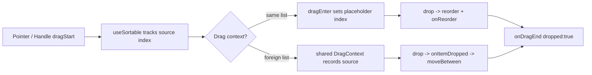

<div align="center">


# react-drag-and-drop

### Lightweight, headless, accessible drag-and-drop list reordering for React.

_Built and maintained by **Viprasol Tech**._

[](https://www.npmjs.com/package/react-drag-and-drop)
[](LICENSE)
[](tsconfig.json)
[](https://react.dev)
[](#-testing)
[](package.json)

</div>

---

## Features

- Tiny & headless — a hook (`useSortable`) for full control, plus a batteries-included `<SortableList />` component. Zero runtime dependencies.
- Native HTML5 drag-and-drop — no portals, no global listeners, no virtual layers.
- Drag handles — restrict dragging to a dedicated handle with `useHandle`.
- Multi-list moves — move items between independent lists with a shared `useDragContext`.
- Drop placeholder — a visible gap shows exactly where the item will land; fully customizable.
- Disabled items — mark items non-draggable / non-droppable with `isDisabled`.
- Keyboard reordering — `Ctrl`/`Cmd` + `Up`/`Down` reorders the focused item and skips disabled neighbours.
- Accessible — `role`, `aria-grabbed`, `aria-disabled`, and focus management out of the box.
- Lifecycle callbacks — `onDragStart`, `onDragEnd` (with a `dropped` flag), and `onReorder`.
- Strict TypeScript — every prop, helper, and payload is fully typed.

## Install

```bash
npm install react-drag-and-drop
# or
pnpm add react-drag-and-drop
# or
yarn add react-drag-and-drop
```

> Requires `react` and `react-dom` `>= 18` as peer dependencies.

## Usage

### Basic sortable list

```tsx
import { useState } from "react";
import { SortableList } from "react-drag-and-drop";

export function Playlist() {
  const [tracks, setTracks] = useState(["Intro", "Verse", "Chorus", "Outro"]);

  return (
    <SortableList
      items={tracks}
      getKey={(track) => track}
      onReorder={({ items }) => setTracks(items)}
      renderItem={(track, { isDragging }) => (
        <span style={{ opacity: isDragging ? 0.5 : 1 }}>{track}</span>
      )}
    />
  );
}
```

### With drag handles and disabled items

```tsx
<SortableList
  items={tasks}
  getKey={(t) => t.id}
  useHandle
  isDisabled={(t) => t.locked}
  onReorder={({ items }) => setTasks(items)}
  renderItem={(task, { handleProps, isDisabled }) => (
    <div>
      {!isDisabled && <button {...handleProps}>::</button>}
      {task.title}
    </div>
  )}
/>
```

### Move items between two lists

```tsx
import { SortableList, useDragContext, moveBetween } from "react-drag-and-drop";

function Board() {
  const ctx = useDragContext();
  const [todo, setTodo] = useState(["A", "B"]);
  const [done, setDone] = useState(["X"]);

  const onDropped = ({ fromListId, toListId, fromIndex, toIndex }) => {
    const src = fromListId === "todo" ? todo : done;
    const dst = toListId === "todo" ? todo : done;
    const res = moveBetween(src, dst, fromIndex, toIndex);
    (fromListId === "todo" ? setTodo : setDone)(res.source);
    (toListId === "todo" ? setTodo : setDone)(res.destination);
  };

  const shared = { context: ctx, onItemDropped: onDropped, getKey: (i: string) => i };

  return (
    <>
      <SortableList {...shared} listId="todo" items={todo} onReorder={({ items }) => setTodo(items)} renderItem={(i) => i} />
      <SortableList {...shared} listId="done" items={done} onReorder={({ items }) => setDone(items)} renderItem={(i) => i} />
    </>
  );
}
```

### Headless hook

```tsx
import { useSortable } from "react-drag-and-drop";

function Custom({ items, onReorder }) {
  const { getItemProps, draggingIndex } = useSortable({ items, onReorder });
  return (
    <ul>
      {items.map((item, i) => (
        <li key={i} {...getItemProps(i)} data-dragging={draggingIndex === i}>
          {item}
        </li>
      ))}
    </ul>
  );
}
```

## How it works



## API

### `<SortableList />` props

| Prop                   | Type                                                  | Default | Description                                                        |
| ---------------------- | ----------------------------------------------------- | ------- | ------------------------------------------------------------------ |
| `items`                | `T[]`                                                 | -       | Ordered items to render (controlled).                              |
| `renderItem`           | `(item: T, helpers: RenderItemHelpers) => ReactNode`  | -       | Renders one item. `helpers` carries drag state and `handleProps`.  |
| `onReorder`            | `(change: SortableChange<T>) => void`                 | -       | Fired with the new order on every in-list reorder.                 |
| `getKey`               | `(item: T, index: number) => string \| number`        | index   | Stable React key per item.                                         |
| `isDisabled`           | `(item: T, index: number) => boolean`                 | -       | Marks an item non-draggable and non-droppable.                     |
| `useHandle`            | `boolean`                                              | `false` | Only `helpers.handleProps` initiates a drag.                       |
| `onDragStart`          | `(info: DragStartInfo) => void`                       | -       | Fired when a drag begins.                                          |
| `onDragEnd`            | `(info: DragEndInfo) => void`                         | -       | Fired when a drag ends (`dropped` indicates a valid drop).         |
| `listId`               | `string`                                              | -       | Identifier required for cross-list moves.                          |
| `context`              | `DragContext`                                          | -       | Shared context from `useDragContext` for multi-list moves.         |
| `onItemDropped`        | `(drop: CrossListDrop) => void`                       | -       | Fired when an item from another list is dropped here.              |
| `renderPlaceholder`    | `() => ReactNode`                                     | divider | Custom drop-placeholder content.                                   |
| `as`                   | `"ul" \| "ol" \| "div"`                               | `"ul"`  | Container element tag.                                             |
| `itemAs`               | `"li" \| "div"`                                       | `"li"`  | Item element tag.                                                  |
| `className` / `itemClassName` / `draggingClassName` / `overClassName` / `disabledClassName` / `placeholderClassName` | `string` | - | Styling hooks for each part. |

### `useSortable(options)` returns

| Field              | Type                                       | Description                                         |
| ------------------ | ------------------------------------------ | --------------------------------------------------- |
| `getItemProps`     | `(index: number) => SortableItemProps`     | Spread onto each draggable item.                    |
| `getHandleProps`   | `(index: number) => DragHandleProps`       | Spread onto a dedicated drag handle.                |
| `draggingIndex`    | `number \| null`                           | Index currently being dragged.                      |
| `overIndex`        | `number \| null`                           | Index currently hovered as a target.                |
| `placeholderIndex` | `number \| null`                           | Where the drop placeholder should render.           |
| `isDragging`       | `boolean`                                  | True while a drag is in flight.                     |
| `move`             | `(from: number, to: number) => void`       | Imperative reorder (used by keyboard handlers).     |

### Helpers

| Export                | Signature                                                                                  |
| --------------------- | ------------------------------------------------------------------------------------------ |
| `reorder`             | `(list, from, to) => T[]`                                                                   |
| `moveBetween`         | `(source, destination, fromIndex, toIndex) => { source: T[]; destination: T[] }`           |
| `getDropIndex`        | `(tops, heights, pointerY) => number`                                                       |
| `normalizeInsertIndex`| `(from, insertIndex) => number`                                                             |
| `useDragContext`      | `() => DragContext`                                                                          |

## Keyboard

| Keys                    | Action                                  |
| ----------------------- | --------------------------------------- |
| `Tab`                   | Focus the next item.                    |
| `Ctrl`/`Cmd` + `Up`     | Move focused item up (skips disabled).  |
| `Ctrl`/`Cmd` + `Down`   | Move focused item down (skips disabled).|

## Roadmap

- [x] Headless `useSortable` hook
- [x] `<SortableList />` component
- [x] Drag handles
- [x] Multi-list (move between lists)
- [x] Drop placeholder
- [x] Disabled items
- [x] `onDragStart` / `onDragEnd` callbacks
- [x] Keyboard reordering
- [ ] Horizontal & grid layouts
- [ ] Auto-scroll on drag near edges
- [ ] Touch/pointer-events backend (mobile)
- [ ] Animated transitions (FLIP)

## FAQ

**Is this controlled or uncontrolled?**
Controlled. You own `items`; the component reports changes via `onReorder` / `onItemDropped`.

**Does it work on touch devices?**
It relies on the HTML5 Drag-and-Drop API, which has limited touch support. A pointer-events backend is on the roadmap; keyboard reordering works everywhere today.

**Can I style the drag ghost?**
Use `draggingClassName` (and `helpers.isDragging`) to style the source element. The native drag image follows the browser default.

**Do I need the `<SortableList />` component?**
No - `useSortable` is fully headless if you want to render everything yourself.

## Testing

```bash
npm install
npm test          # vitest run - 49 tests
npm run typecheck # tsc --noEmit
```

## Contributing

Contributions are welcome! Please open an issue to discuss substantial changes first. Run `npm test` and `npm run typecheck` before submitting a PR, and keep the strict-typed, zero-dependency, fully-tested standard. See [CONTRIBUTING.md](CONTRIBUTING.md).

## Contact — Viprasol Tech Private Limited

- Website: [viprasol.com](https://viprasol.com)
- Email: [support@viprasol.com](mailto:support@viprasol.com)
- Telegram: [t.me/viprasol_help](https://t.me/viprasol_help) | WhatsApp: +91 96336 52112
- GitHub: [@Viprasol-Tech](https://github.com/Viprasol-Tech) | [LinkedIn](https://www.linkedin.com/in/viprasol/) | X [@viprasol](https://twitter.com/viprasol)

## License

[MIT](LICENSE) (c) 2025 Viprasol Tech Private Limited
